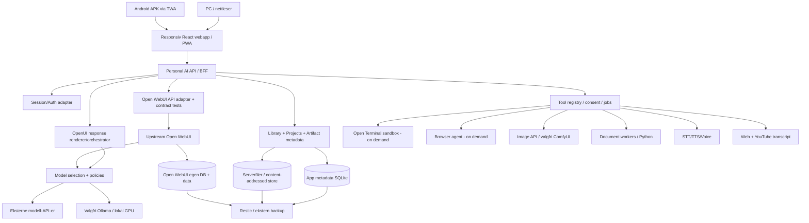

# Personal AI Workspace — Fullstendig målarkitektur

**Status:** Byggespesifikasjon, ikke ferdig implementasjon  
**Dato:** 2026-10-14  
**Hovedmål:** Selvhostet, oppdaterbar og ressursbesparende ChatGPT-lignende plattform, med samme funksjoner i web og Android-app.  
**Maskinvare:** Lenovo Legion 5 15ARH05H; Ryzen 5 4600H, 16 GB RAM, RTX 2060 6 GB VRAM, 512 GB SSD.  
**Målgruppe:** 1–5 private brukere først, men kode og installasjon skal kunne deles offentlig på GitHub.  
**Ikke-mål:** Påstå at alle ChatGPT-funksjoner, modellegenskaper, GPT-6 Intelligent UI eller sanntidstale er 1:1 identiske. Oppnå funksjonell dekning og dokumenter forskjeller.

## 0. Prinsipper og harde krav

1. **Upstream først:** Ikke vedlikehold permanente endringer inne i Open WebUI, OpenUI, Open Terminal eller andre upstream-kildekoder. Bruk dokumenterte API-er, egne adaptere og egne moduler. Hvis en nødvendig funksjon mangler offentlig integrasjonspunkt, dokumenter gapet og velg en isolert adapter, ekstern arbeidsflate eller et eksplisitt, testet unntak. Aldri skjør DOM-injeksjon som primærløsning.
2. **Ett grensesnitt:** Samme responsive webklient skal brukes i desktopnettleser, Android PWA og Android APK/AAB (Trusted Web Activity eller annen webshell). Ingen andreklasse-versjon av Library, Work eller Intelligent UI på mobil.
3. **Få prosesser:** Hold basisinstallasjonen til Open WebUI + en liten utvidelses-API og valgfri reverse proxy/Tailscale. Frontend bygges statisk. Terminal, browser, lokal modell, transkripsjon, bilde-workflow og indeksering aktiveres ved behov. Ikke kjør Kubernetes, Redis, Qdrant, Nextcloud, n8n, ComfyUI og gateway uten begrunnet behov.
4. **Dataeierskap:** Chatter, vedlegg, filer, metadata, minne, oppgaver og genererte artefakter lagres på serveren og kan eksporteres. Filer lagres én gang og refereres fra flere objekter. Ikke eksponer API-nøkler til klienten.
5. **Trygge oppdateringer:** Versjonslås alle deployerbare dependencies; backup før migrering, staging/test på kopi, kontrakttester og dokumentert rollback av BÅDE kode og data.
6. **Alle funksjonsområder:** Se `FEATURE_MATRIX.md`. Ingen funksjon kan markeres 'ferdig' uten automatiserte og manuelle akseptansetester på desktop og Android.
7. **Åpen GitHub-distribusjon:** En tydelig OSS-lisens på vår egen kode; bevar upstream-lisenser, attributter og eventuelle brandkrav. Ingen nøkler/persondata, betalte filer eller modellvekter inn i Git.
8. **Billig drift:** Ingen nødvendig VPS. Basiskonfigurasjon med skybasert modell er ment for 16 GB RAM. Faktiske målinger, strøm og API-forbruk logges. Ikke lov et bestemt RAM-budsjett uten målinger.
9. **Sikkerhet først:** Agenten får ALDRI root, Docker socket, NAS-root, hele home eller databasecredentials. Sandkasse med ressursgrenser, minimumsrettigheter, egendefinert egress og eksplisitt godkjenning ved sideeffekter.
10. **Progressiv leveranse:** Først fungerende enkel installasjon. Deretter full funksjonsdekning med feature flags, versjonsmigreringer og testede adaptere.

## 1. Viktig arkitekturavklaring: hva som faktisk kan oppdateres uavhengig?

Open WebUI har mange innebygde funksjoner og server-side tool calling. Men det generelle REST-API-et beskrives delvis som eksperimentelt. En fullstendig egen frontend **kan derfor ikke garanteres å overleve enhver fremtidig upstream-endring automatisk**. Vi isolerer ALLE slike kall i `openwebui-adapter` og kjører kompatibilitetstester mot pinnede serverversjoner. Ustabile kall markeres som slike i kode og `COMPATIBILITY.md`.

To frontendnivåer:

- **Bootstrap/første fungerende versjon:** Standard Open WebUI PWA og adminfunksjoner brukes direkte. Utvidelsene eksponeres som dokumenterte MCP/OpenAPI-tools og eventuelt separate, autentiserte undersider. Ingen skjør modifisering av frontend.
- **Full produktversjon:** Én egen, responsiv React-klient med samme sider og Intelligent UI på PC og Android. Klienten snakker med vår server-API (`/v1/...`), som oversetter til godkjente Open WebUI-endepunkter, samt lagrings- og verktøy-API. Egen frontend er nødvendig for full kontroll over Library-side, Work-side, Images-galleri, native Android-workflows og Intelligent UI direkte i chattråden. Dette er større utviklingsarbeid; ikke kall det ferdig før funksjonsparitet er testet.

**Valgt sluttarkitektur:** Egeneid frontend + stabilisert adapter foran Open WebUI. **Valgt oppstart:** Offisiell Open WebUI PWA mens egen frontend utvikles. Ikke to permanent vedlikeholdte brukergrensesnitt.

## 2. Systemdiagram



**Merk:** Diagrammet beskriver logiske komponenter, ikke én container per boks. `Personal AI API`, Library, policy, jobbstyring og adapter kan være én lett prosess. OpenUI er primært et frontendbibliotek, ikke en permanent server. Open WebUI beholder sin egen database som vi aldri endrer direkte.

## 3. Teknologistakk

| Lag | Standard | Kommentar |
|---|---|---|
| Host | Ubuntu Server 24.04 LTS | Lokk igjen uten suspend, energiprofil, nettverkskabel, SSH |
| Container | Docker Engine + Compose | Ingen Kubernetes |
| Backend upstream | `open-webui/open-webui` via offisiell Docker-image | Pin semver/tag + digest; behold branding/lisens |
| BFF/utvidelses-API | FastAPI (Python) **eller** Hono/Fastify (TypeScript), velg kun én | Velg enklest etter prototype; OpenAPI-kontrakt |
| Frontend | React + TypeScript + Vite (statisk produksjonsbuild) | Unngå kontinuerlig Node-server |
| Intelligent UI | `thesysdev/openui` (`@openuidev/react-lang`, UI-bibliotek) | MIT; validert OpenUI Lang, statisk whitelist |
| Android | PWA + Android TWA med Bubblewrap | Én UI-kodebase og signert APK/AAB; HTTPS + Digital Asset Links |
| Applagring | SQLite WAL + Alembic/tilsvarende migrering for egen metadata | Open WebUI har separat DB; ingen delte tabeller |
| Objektlager | Lokale filer med hash/UUID + filer/metadata | Fremtidig valgfri S3-adapter; ingen krav nå |
| Fulltekstsøk | SQLite FTS5 for appmetadata | Kunnskap/RAG håndteres først av Open WebUI |
| Vektorsøk | Bruk Open WebUI Knowledge og eksisterende vector store | Ikke start egen Qdrant ved 1–5 brukere |
| Auth | Open WebUI-identitet gjennom dokumentert/isolert adapter | Same-origin, sikre httpOnly-cookies for egen BFF; CSRF; ikke lagre token i localStorage |
| AI | Open WebUI sine leverandørintegrasjoner | Remote først; lokal GPU etter behov |
| Bilde | Open WebUI sin Image API-integrasjon; valgfri lokal ComfyUI | Editing/inpainting må ha støttet modell |
| Kode/filer | Isolert Open Terminal + verktøybibliotek | Minst privilegier; sikker fil-eksport |
| Nettleser | Valgfri browser-use/Playwright worker, on-demand | Separate browserprofiler per bruker; ingen host browsing |
| Søk | Open WebUI web search; alternativ leverandør | Kostnad/kvote, kilder og caching |
| Tale | Enkelt STT/TTS via innebygd støtte; valgfritt realtidsadapter | Realtime voice kvalitet/kostnader varierer |
| Scheduler | Open WebUI Automations/Calendar | Bruk eksisterende før egen jobbplanlegger |
| Access | Tailscale først + HTTPS | Ikke eksponer Docker-kontainere direkte |
| Backup | Restic til ekstern USB-disk, NAS eller kompatibel sky | Kryptert offsite, restore-test |
| Observability | Docker logs, enkel metrics/health, måling av API-kostnad | Ikke tung overvåkningsplattform som standard |

### 3.1 Lisenser og attribusjon

- **Open WebUI:** Versjoner 0.6.6+ har egne lisens- og brandingvilkår. Ikke kall hele produktet MIT. Offentlig distribusjon må følge upstream-lisensen per valgt versjon; behold synlig Open WebUI-branding med mindre unntak/permission dekker bruken. Privat installasjon med <=50 brukere/30 dager kan falle inn under eksplisitt rebrand-unntak. Les gjeldende lisens ved hver større oppgradering.
- **OpenUI:** GitHub oppgir MIT (verifiser LICENSE for versjon som inkluderes).
- **Conduit (valgfritt):** GPL-3.0. Ikke kopier Flutter-kode inn i egen proprietær klient; ved forking/distribusjon overhold GPL. Vi velger primært PWA/TWA for å slippe dobbel klient og GPL-vedlikehold.
- **CopilotKit demo:** MIT. Kan brukes som inspirasjon, ikke nødvendig runtime-avhengighet.
- **Tredjeparts plugins, fonter, modeller og bilder:** Egne lisenser og vilkår. Bygg `THIRD_PARTY_NOTICES.md`, SBOM og dependency audit.
- Egen kode: foreslå MIT *for egen modul-/clientkode*, forutsatt at avhengighets- og lisensgjennomgang tillater det. Ikke gi inntrykk av at MIT overstyrer tredjepartskode.

## 4. Domener, kilder og datakontrakter

**Open WebUI eier:** chat-data, innebygde memories, notater, Knowledge, prompt/profil, modelloppsett, innebygde automasjoner, brukere og rettigheter. Bruk deres egne API-er, ikke SQL inn i deres database.

**Egen app eier:** file registry, mappe-/favorittmetadata for Library, artefaktversjoner, projects-tilknytningsmetadata, UI-state, Work-runnerstatus, eksportmanifest, kompatibilitetstabell. Prosjektet kan referere til Open WebUI chat IDs, men må tåle at upstream endrer representasjon. Eksterne ID-er ligger bak adapter og referansetabell.

### 4.1 Minimal intern domenemodell

```text
UserRef(id, upstream_user_id, created_at)
Project(id, owner_id, name, description, settings, created_at)
ProjectMember(project_id, user_id, role)
LibraryItem(id, owner_id, sha256, storage_key, mime_type, filename, bytes, created_at, source_type)
LibraryReference(id, item_id, target_type, target_id, role)
Collection(id, owner_id, name, parent_id)
CollectionItem(collection_id, item_id)
Favorite(user_id, item_id, created_at)
Artifact(id, owner_id, library_item_id, kind, producer, version, provenance_json)
UIArtifact(id, owner_id, chat_ref, schema_version, source_lang, serialized_state_json)
WorkRun(id, owner_id, project_id, status, steps_json, approvals_json, output_refs)
TaskRunRef(id, upstream_automation_id, notifications_state)
IntegrationGrant(id, user_id, provider, scope, encrypted_token_ref)
ProviderUsage(id, user_id, provider, model, estimated_cost, tokens, timestamp)

No stored plaintext provider secrets. All authorizations enforced server-side.
```

### 4.2 Filer og Library

- Alle genererte og opplastede filer får stabile ID-er, SHA-256 og MIME-verifisering; deduplisering **innenfor tilgangsgrensen**.
- Library har faner **All / Suggested / Favorites / Images / Folders** samt sortering, filtrering, gjenbruk i chat, metadata, versjoner, export og delete. `Suggested` krever eksplisitt relevanslogikk, ikke automatisk full tilgang til alt.
- Bruk link/referanser chat↔fil↔project; sletteoperasjoner må rydde referanser sikkert (soft delete/retention før fysisk sletting).
- Store filer chunkes ved opplasting; størrelsesgrenser; virus-/ZIP-bombesjekk; sti-/filnavnsanitizing; ingen lesing av vilkårlige host-stier.
- For eksterne Open WebUI-filer: referanse/konnektor framfor blind kopi. Ikke anta ubegrenset og stabil intern file API. Test kontrakter mot pinna versjon.
- NAS gir SMB for private menneskestyrte mapper, **ikke** API-agentens tilgang til NAS-root. Filserver er valgfri profil; del bare dedikerte mapper.

### 4.3 Memory og personlig kontekst

- Open WebUI Memory som kanonisk minne i fase 1.
- UI: vis, rett, slett og eksporter minner; kilde og tidspunkt; skille varig minne fra chatutdrag og Knowledge.
- Ikke lag sensitive minner automatisk uten passende kontroll. Respekter eksplisitte ønsker om sletting; demonstrer konsekvens for backup-retention.
- Prosjektminne må aldri lekkes mellom private prosjekter/brukere.
- Semantisk søk over chatter/minner kan senere utvides, men start med Open WebUI søk og SQLite FTS for Library.

### 4.4 Projects / Workspaces

- Project header: chatter, filer, Knowledge sources, instruksjoner, tasks, artifacts, relaterte notes, work runs.
- Scope leverandørverktøy etter project ID og bruker, ikke kun systemprompt.
- Workspace er delbar organisering, ikke et parallelt chatarkiv.

## 5. Alle funksjonsområdene

Se den testbare `FEATURE_MATRIX.md`. Implementer disse områdene: Chat, Search, Library, Knowledge, Memory, Notes, Projects, Files, Images gallery, Web search, Deep Research, Data Analysis, Code Execution, Document Creation, Image Generation & Editing, Voice, Plugins/Connectors, Automations/Tasks, Personalization, Settings/Account, YouTube summaries, Work/Computer Use og Intelligent UI.

### 5.1 AI-modeller og provider routing

- Modeller defineres dynamisk fra Open WebUI; profiler **Fast / Smart / Local / Vision / Image / Voice**.
- Brukersystemet skal vise provider, prisestimat og hvilke verktøy/moduser modellen støtter, og returnere begripelig fallback ved manglende funksjon.
- Ikke anta at **OpenCode Go** tillater generell AI-chat eller vil fungere som universell provider; kun bruk ved verifisert teknisk og avtalemessig støtte. Støtt kompatible betalte eller gratis API-er på riktig måte.
- Ikke send dokumenter, passord eller hele Memory til eksterne AI-provider uten tydelig brukerhandling, minimert kontekst og forståelige personvernvalg.
- Lokale modeller: start bare ved behov; GPU 6 GB setter klare begrensninger på modellstørrelse, kontekst og bildekvalitet.

### 5.2 Intelligent UI

**Mål:** AI velger vanlig tekst som standard og interaktiv komponent bare når nyttig. OpenUI Lang brukes for dokumenterbare komponenter (kort, diagrammer, tabeller, kart, sliders, skjema, quiz, kalkulator, bildegalleri). Behold en allowlist med versjonerte prop-skjemaer.

- Output typer `markdown`, `tool_result`, `openui_document`, `artifact_file`.
- UI-dokument lagres i `UIArtifact` med schema_version, bruker, tilhørende chat, state og kildeversjon; rendres identisk på desktop og Android TWA.
- Streaming parser validerer og oppgraderer skjema. Feil fallback = trygg markdown og feilmelding, ikke blank skjerm.
- UI-interaksjoner påvirker bare lokal state med mindre brukeren aktivt sender en ny handling. Skrivende API-kall krever godkjenning og CSRF/permission check.
- Dynamisk JS/HTML fra modell får ikke kjøre fritt i samme origin som autentisert applikasjon. Om kodeartefakter tillates, bruk isolert iframe med streng sandbox/CSP og egen origin; ingen cookies, tokens, `allow-same-origin` eller skjult nettverkstilgang.
- Kart, bilder og videosøk skal ikke automatisk sende geolokasjon til tredjepart. Bruk nettleserbasert interaksjon, men lagre reproduserbart komponent-innhold.
- Default backend: lokal promptgenerering/validering med OpenUI, uten obligatorisk betalt Thesys Gateway. Gateway som valgbar adapter hvis funksjonen er nødvendig og kostnad er godkjent.

### 5.3 Research og YouTube

- Web search: kilde-URL, tittel, hentetid, tekstutdrag og forklaring for hvert viktig faktum; vis om web-søk faktisk ble brukt.
- Deep Research: plan → kildeinnhenting → deduplisering → verifisering → utkast → faktasjekk → rapport med kilder og lagret output. Sett max sider, max tokens, kostnadsbudsjett, timeout.
- YouTube: URL → metadata → tilgjengelige captions/tekst → oppsummering med tidsstempler bare når korrekte tidsdata finnes. Manglende captions → brukerkontrollert lyd/STT-fallback. Ikke gi inntrykk av analyse av visuelle frames når kun transkripsjon er brukt. Respekter plattformvilkår.

### 5.4 Work / agenter

- **WorkRun** har plan, status, bevis, filer, verktøykall, budsjett og stop/cancel.
- Bruk Open WebUI server-side tools og Open Terminal for filgenerering/code execution; browser agent er på-demand.
- Policy nivå: read-only kan auto; skrive til lokale prosjektfiler ved forespurt action; destruktive handlinger, innlogging, sende meldinger, økonomiske transaksjoner, publisering eller ekstern posting krever godkjenning.
- Terminal kjører med CPU/RAM/pids/time/disk quota, non-root, seccomp, uten Docker socket, uten privat token/host home; egress allowlist etter oppgavetype.
- Work-artifact overføres fra sandbox via kontrollert filimport som MIME-sjekkes og registreres i Library. Resultatene presenteres med verifiserbare fil-URL-er til autentisert app.

### 5.5 Dokumentproduksjon og dataanalyse

Støtte: PDF, DOCX, XLSX, PPTX, ODS (best-effort), CSV, TXT, MD, HTML, JSON, YAML, ZIP, SVG, PNG, JPG, WebP og kildekode. Bruk bibliotekene `python-docx`, `openpyxl`, `python-pptx`, `reportlab`/`weasyprint` etter lisenskontroll, `pandas`, `matplotlib` og `Pillow`.

- Både opprette og redigere eksisterende dokumenter; bevar originalene eller eksplisitt lag ny versjon.
- Excel: formler, datatyper, diagrammer, styling og gjenåpning med en standard leser.
- PDF: gjenåpningskontroll + utsnitt/sidestørrelse; sjekk at tegnsett fungerer.
- Word/PPTX: test med parsere, ikke bare filendelse; vis eksempelpreview eller thumbnail når tilgjengelig.
- Alle filgenereringstester må faktisk åpne filene og verifisere struktur før artifakt markeres ferdig.
- Filnavn, tilgang og nedlastningslenke må ha begrenset varighet og autorisasjon. Når ny fil genereres, lagre/registrer den i Library.

### 5.6 Bildegenerering og bilderedigering

- `generate_image(prompt, size, style, count)` og `edit_image(source_file_id, instruction, mask_file_id?)` med kapabilitetskontroll.
- Standard: ekstern image API som Open WebUI dokumenterer. Bruker kan sette prisgrense og bekrefte kostnad per generering.
- Lokal ComfyUI med minneeffektive workflows som valgfri Docker-profil; start GPU-container ved behov; test at valgt modell faktisk får plass på RTX 2060 6 GB VRAM. Ikke påstå at store moderne diffusion-modeller kjører stabilt på denne GPUen.
- Lagre originale input og output som separate objekter med lineage, EXIF-handtering, thumbnails og versjoner.
- Image gallery: genererte, redigerte og opplastede bilder, filtrering, gjenbruk, eksport.

### 5.7 Voice, multimodal og meldinger

- STT, TTS, opptak, mikrofontillatelse, lydbaserte vedlegg og standard talechat i første fase.
- Full-dupleks low-latency realtime voice er separat optional adapter og kan kreve spesialisert kommersiell API; mål latens før 'ferdig'.
- Android TWA kan ha plattformbegrensninger for bakgrunnslyd, share-sheet, varsler og hardwareintegrasjon. Native tillegg implementeres som Android-only bridging ved behov, men alltid med identisk funksjonell tilgang i web via fallback.
- Kamera, lydopptak og bildeinnsending støttes etter Android tillatelsestest.

### 5.8 Plugins / Connectors og Tasks

- MCP/OpenAPI primært via Open WebUI, leverandørspesifikke autentiseringer med scoped tokens.
- Ingen plugin får private filer, hele chatloggen eller integrasjonstokens uten eksplisitte grants.
- Bruk Open WebUI Automations/Calendar før egen scheduler. Hvis automatiserte jobber trenger ekstern push til Android, opprett en minimal notif-adapter; dokumenter at PWA-webnotifikasjoner i Open WebUI ikke tilsvarer alltid-på push mens app er lukket.
- Varsler og planlagte oppgaver må respektere tidssone, DST, paused state, feilhåndtering og retries.

## 6. Frontend UX og Android 100 % funksjonsparitet

**En delt responsiv UI-komponentkodebase, tre leveringsformer:** desktop browser, installert PWA, signert Android TWA APK/AAB. Alle funksjonsruter skal kunne testes i Chrome desktop og i Android-appen.

Navigasjon (venstremeny desktop / bottom nav + drawer mobil):

```text
New Chat
Search
Library     [All · Suggested · Favorites · Folders · Images]
Knowledge
Memory
Notes
Projects
Work        [Runs · Research · Terminal · Artifacts]
Tasks       [Automations · Calendar]
Images
Settings    [Models · Integrations · Voice · Privacy · Backup]
```

- UI skal være profesjonell, responsiv, tastaturnavigerbar og tilgjengelig (WCAG 2.2 AA som mål).
- Artifacts/Intelligent UI vises **inne i samtalen**, med modal/fullskjerm på mobil uten funksjonstap.
- Handlinger: copy, edit, regenerate, branch, share/export, pin, favorites, attach library file, model picker, reasoning toggle, budget.
- Mobile: native fildialog, bildeplukker, mikrofon, kamera, touch, Android tilbakeknapp, del-til-app (TWA Share Target hvis støttet og testet), deep links. Ikke hev at funksjonen er implementert før fysisk Android-test.
- Frakoblet visning: begrenset cache av UI shell og eksplisitt valgte dokumenter; ingen løfter om lokale genereringer uten modell/tilkobling.
- Appen må ha eget navn/ikon på tillatt måte; vurder Open WebUI-brandingbestemmelser før offentlig release.

## 7. Sikkerhet og personvern

- Kun lokalnett/Tailscale som standard. Hvis offentlig eksponering velges: HTTPS, rate limit, sikker reverse proxy, logging uten hemmeligheter, patching, CSRF, cookie/SameSite og brute-force vern.
- Ikke eksponer Terminal, ComfyUI, Ollama, database eller admin-endepunkter mot internett.
- Sandkassede agenter og HTML. Filuploads må skannes/saniteres; blokkér path traversal, SSRF, prompt injection fra dokumenter/nettinnhold, XSS, MIME spoofing og zip bombs. Nettleseragent må ikke kunne nå private RFC1918/nettverksressurser som standard.
- API-nøkler i `.env`/Docker secrets utenfor Git; `chmod 600`, bruk HTTPS, token-rotasjon og aldri logg secrets.
- Sikker slettefunksjon med retention; dokumenter backup-effekten.
- Ingen ukritiske anrop fra AI-verktøy til vilkårlige URL-er; egress policy og user consent.
- Privilege separation: egen uid/gid for hver tjeneste, ro rootfs der mulig, resource limits, healthchecks, restart policies.
- Supply chain: pin digests, SBOM, Trivy/Dependabot/Renovate, signering/attestasjoner hvis distribusjonsnivå krever det.

## 8. Update- og kompatibilitetsstrategi

1. Bruk offisielle, versjonslåste images og npm/pip lockfiles. Aldri `latest` i produksjon.
2. Renovate/Dependabot lager PR-er, ikke automatisk produktdeploy. Oppdater en primærdependency av gangen der risikoen er høy.
3. CI sjekker lisens/SBOM, statisk analyse, unit-/kontrakttest og Docker build.
4. Test ny Open WebUI mot `openwebui-adapter` i en midlertidig staging med **kopi av data** (helst syntetisk/anonymisert). Bekreft chat streaming, auth, uploads, Memory, automations, tools, imagegen, files og UI.
5. Test migrering av separat appdatabase på kopi. Test serverens upstream-migrering på kopi. Kjør restore-test før produksjonsoppgradering.
6. Backup som består av app DB, Open WebUI DB, vedlegg, filobjekter, konfig og secrets-manifest (ikke hemmeligheter i offentlig repo).
7. Hvis grønt: deploy i vedlikeholdsvindu, kjør smoke-test på fysisk Android + web. Hvis rødt: stopp og behold fungerende versjon.
8. Ved feil etter migrering: restore matching snapshots av **begge** databaser og objektene, og gammel image digest. Bare nedgradering av container-image kan ikke garanteres å reversere DB-migrering.
9. Ved upstream breaking change: adapter skal degradere funksjon med tydelig feilmelding, ikke krasje hele UI. Opprett issue i eget repo og oppdater `COMPATIBILITY.md`.
10. Opprett til enhver tid en støtte-matrise over versjonene: UI↔BFF↔Open WebUI↔OpenUI↔Android wrapper.

Mer detaljert i `UPDATE_POLICY.md`.

## 9. Backup/restore/lagring

- Data utenfor containere, kryptert backup via Restic, helst ekstern USB-disk/NAS og minst én offsite-kopi hvis viktig.
- Daglig inkrementell backup; før oppgraderinger alltid snapshot, og periodisk full restore-test til separat sted.
- SQLite: ta konsistent online backup via sqlite3 backup API eller stopp tjenesten før snapshot; ikke kopier tilfeldig WAL i produksjon uten konsistensgaranti.
- Backup-kryptering og nøkkelgjenoppretting dokumentert. Retention f.eks. 7 daglige, 4 ukentlige, 6 månedlige; konfigurerbart.
- Beregn faktisk plassbruk: 512 GB SSD må ha fri plass til opplastinger, tempgenererte dokumenter og eventuelle modellfiler. Stor NAS kan kreve ekstern disk.
- `restore` må være en reell, testet kommando (verifiser at både fil- og chatdata dukker opp).

## 10. Ressurser og strøm

**Alltid på:** Host OS, Open WebUI, lett BFF med Library metadata, eventuelt proxy og Tailscale. React UI er statiske filer. 16 GB RAM er tilstrekkelig for lett privat web-/API-bruk, men faktisk RAM må måles i tester. Velg konservative CPU/RAM/disk-kvoter, ikke globale antatte tall.

**On-demand (feature flags):** Open Terminal (minnegrense 1–2 GB i grunnmodus), Playwright/browser (1–3 GB avhengig av Chrome), ComfyUI (kan være langt over 6 GB VRAM i enkelte workflows), Ollama (modellavhengig), tung STT, reindeksering.

- Ikke last lokale LLM-er i RAM/GPU når de ikke brukes.
- Ikke start browser-agent per chat; kø med samtidighetsgrense 1 først.
- GPU-containere: serialiser tunge jobber og avslutt på idle; NVIDIA-drivere verifiseres.
- Rate-limit bildemodeller og eksterne API-er; UI viser kostnad per oppgave og månedlig tak.
- Logg `docker stats`, strømforbruk, GPU-minne og responstider før optimalisering. Målt tomgangsstrøm er mer relevant enn navneplate på laderen.

## 11. Oppsett for vanlige brukere

Et offentlig GitHub-repo skal gi **installasjon med ett kommandooppsett**, selv uten utviklerkunnskap:

1. Installer Docker på Linux, klon repo, kjør `./install.sh` (eller dokumentert tilsvarende). Scriptet sjekker minne, disk, arkitektur, Docker Compose, port, sikkerhet og genererer secrets.
2. Interaktiv installasjonsveiviser: base URL (localhost/LAN/Tailscale), admin, modellprovider, valgfritt bilde-API, backuplokasjon og valgfri GPU.
3. Script starter basisprofil, kjører health, skriver LAN/Tailscale URL og videre steg. Ikke påstå at det åpner ekstern tilgang før test.
4. Brukere installerer PWA på Android, eventuelt laster ned signert APK fra GitHub Releases når TWA bygges. APK må knyttes til et faktisk kontrollert HTTPS-domene (Digital Asset Links); private IP-adresser alene er ikke nødvendigvis nok for TWA verifikasjon.
5. `./manage.sh status|backup|restore|check-updates|upgrade|diagnostics` med lettfattelige feilmeldinger, støtte for non-interactive CI, `--dry-run` og dokumenterte preconditions.
6. Ingen manuell kopi av API-nøkler til mobil; autentisering og tokens administreres sikkert på server.

## 12. Repository, GitHub-distribusjon og pipeline

```text
personal-ai-workspace/
├── README.md
├── LICENSE                     # kun egen kode; THIRD_PARTY_NOTICES styrer upstream
├── THIRD_PARTY_NOTICES.md
├── CONTRIBUTING.md
├── SECURITY.md
├── CHANGELOG.md
├── .env.example
├── .gitignore
├── compose.yaml
├── compose.gpu.yaml            # valgfri profil
├── compose.browser.yaml        # valgfri profil
├── versions.lock
├── install.sh
├── manage.sh
├── apps/
│   ├── web/                    # React/Vite, PWA, OpenUI renderer
│   ├── android/                # Bubblewrap/TWA project, signing ikke i Git
│   └── api/                    # lett BFF + API adapters
├── packages/
│   ├── contracts/              # OpenAPI/schema/generated clients
│   ├── openwebui-adapter/      # all upstream-kobling samlet
│   ├── library/                # file metadata and content store
│   ├── artifact-tools/         # document generation adapters
│   ├── intelligent-ui/         # OpenUI library/renderer bridge
│   ├── policy/                 # permissions, grants, approvals
│   └── testing/                # fixtures and contract suites
├── profiles/
│   ├── terminal/
│   ├── browser/
│   └── image-local/
├── scripts/
│   ├── backup.sh
│   ├── restore.sh
│   ├── upgrade.sh
│   └── verify-environment.sh
├── tests/
│   ├── unit/
│   ├── integration/
│   ├── contract/
│   ├── e2e-web/
│   ├── e2e-android/
│   └── backup-restore/
├── docs/
│   ├── ARCHITECTURE.md
│   ├── FEATURE_MATRIX.md
│   ├── API_CONTRACTS.md
│   ├── SECURITY.md
│   ├── INSTALL.md
│   ├── OPERATIONS.md
│   ├── UPDATE_POLICY.md
│   ├── COMPATIBILITY.md
│   ├── CONTRIBUTING.md
│   └── IMPLEMENTATION_PLAN.md
└── .github/
    ├── workflows/ci.yml
    ├── workflows/release.yml
    ├── workflows/android.yml
    ├── workflows/dependency-check.yml
    └── ISSUE_TEMPLATE/
```

- `main` beskyttet og byggbar; PR-er kjører tester.
- GitHub Actions: lint, typecheck, unit, integration, Open WebUI contract (pinnet), web E2E, Docker build, license scan, secret scan, dependency audit, SBOM, docs validation.
- Release tag produserer kildekode, signert/attestert container der aktuelt, verifiserbar APK/AAB (krever Android signing secrets) og checksums. Aldri last opp Android-signing private keys eller GitHub tokens til repo.
- Publisering og eksterne handlinger krever brukerens eksplisitte godkjenning og en GitHub-konto/tilgang. AI må ikke hevde at repo er publisert uten vellykket `git push` og verifisert GitHub URL.

## 13. Testkriterier og Definition of Done

Minimum før offentlig v1-release:

- `install.sh` fra fersk Linux-maskin starter fungerende system uten manuell hacking.
- Web + Android får identiske brukerrettigheter og alle funksjonssider.
- Upload PDF/PNG/XLSX; gjenbruk fra Library i annen chat; prosjekt-scope; download; favoritter.
- Generer ny PDF, DOCX, XLSX, PPTX og ZIP, verifiser at filene kan åpnes og dukker opp i Library.
- Generer og rediger bilde via minst én dokumentert provider; lineage + galleri + eksport.
- Minne kan leses, oppdateres, slettes og eksporteres; regler respekterer tilgang.
- Agent kan søke på web og produsere research med sitater og dokumenterte kilder.
- YouTube med captions gir korrekt tekstbasert sammendrag; uten captions gir ærlig fallback.
- Intelligent UI: minst interaktiv kalkulator, graf, tabell, quiz, form og kart der data er tilgjengelig, inkludert Android etter reload.
- Automasjon kan settes opp, kjøres og stanses; korrekt tidssone/varsler.
- Work-agent i sandkasse genererer filer, ber om godkjenning ved sideeffekter og kan stoppes.
- Ingen hemmeligheter i repo, JS bundle, klientlagring eller logs. Agent får ikke Docker-socket eller vilkårlige vertsmapper.
- Funksjons- og sikkerhetstester grønt, helsestatus ok, backup + restore verifisert.
- Oppgrader upstream mot staging og rull tilbake testdatabase uten datatap.
- Dokumentert licens, kompatibilitetsmatrise, support policy og bug report template.
- Ressursbruk på Legion testet i tomgang, web-chat, to dokumentjobber og én AI-jobb om gangen. Skriv faktiske tall, ikke gjetninger.

## 14. Leveransefaser og prioritering

1. **Discovery/ADR:** Verifiser API-kontrakter, lisenser, Android TWA-begrensninger; beslutningslogg. Publicer kun dokumentasjon/PoC først.
2. **Bootstrap:** Open WebUI PWA, Tailscale, persistent data, sikker model config, backup/restore.
3. **Egen web/BFF:** En brukerflyt på tvers av data, adaptertester, auth, streaming og mobilresponsivt UI. Første Android PWA.
4. **Library/Projects:** Filindeks og full funksjonalitet uten direkte Open WebUI DB-tilgang.
5. **Files/Images:** Filverksted, PDF/DOCX/XLSX/PPTX/ZIP, imagegen/edit, Gallery; validering.
6. **Intelligent UI:** OpenUI-komponenter, streaming, lagring, interaksjoner, Android-paritet.
7. **Research/Work:** Web/YouTube, sandbox, browser, approval flows, citation checks.
8. **Voice/Tasks/Connectors:** Innebygde funksjoner + mobil-varsler og avanserte adaptere.
9. **Hardening & distribution:** Sikkerhet, ytelse, automatiske kontrakttester, oppdateringsrutine, signed Android release, GitHub releases.

**Release-merking:** `planned`, `implemented`, `verified` med testcase og konkret issue; aldri vis manglende features som ferdige.

## 15. Kilder og videre lesing (kontrollert 2026-10-14)

- Open WebUI docs og funksjoner: https://docs.openwebui.com/features/
- Open WebUI eksperimentelt API: https://docs.openwebui.com/reference/api-endpoints/
- Open WebUI server-side tools: https://docs.openwebui.com/reference/server-side-tool-calling/
- Open WebUI PWA: https://github.com/open-webui/docs/blob/main/docs/getting-started/open-webui-as-app.md
- Open WebUI automations: https://docs.openwebui.com/features/chat-conversations/chat-features/automations/
- Open WebUI bildegenerering/redigering: https://docs.openwebui.com/features/chat-conversations/image-generation-and-editing/usage/
- Open Terminal og sikkerhet: https://docs.openwebui.com/features/open-terminal/advanced/security/
- Open WebUI lisens og branding: https://docs.openwebui.com/license/
- OpenUI: https://github.com/thesysdev/openui
- Thesys Intelligent UI demo: https://github.com/thesysdev/open-intelligent-ui
- CopilotKit Intelligent UI demo: https://github.com/CopilotKit/OpenIntelligentUI
- Conduit (valgfritt, GPL-3.0): https://github.com/cogwheel0/conduit
- Android TWA og Digital Asset Links: https://developer.android.com/develop/ui/views/layout/webapps/guide-trusted-web-activities-version2
